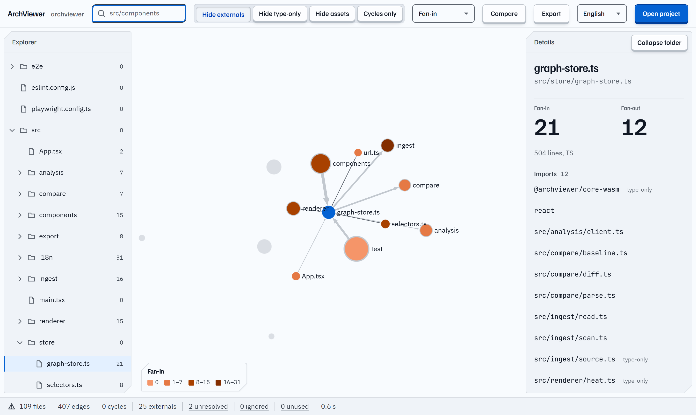
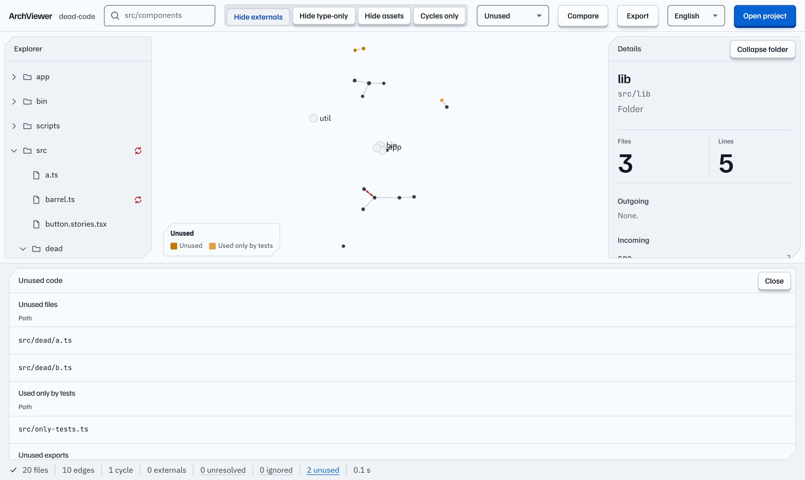
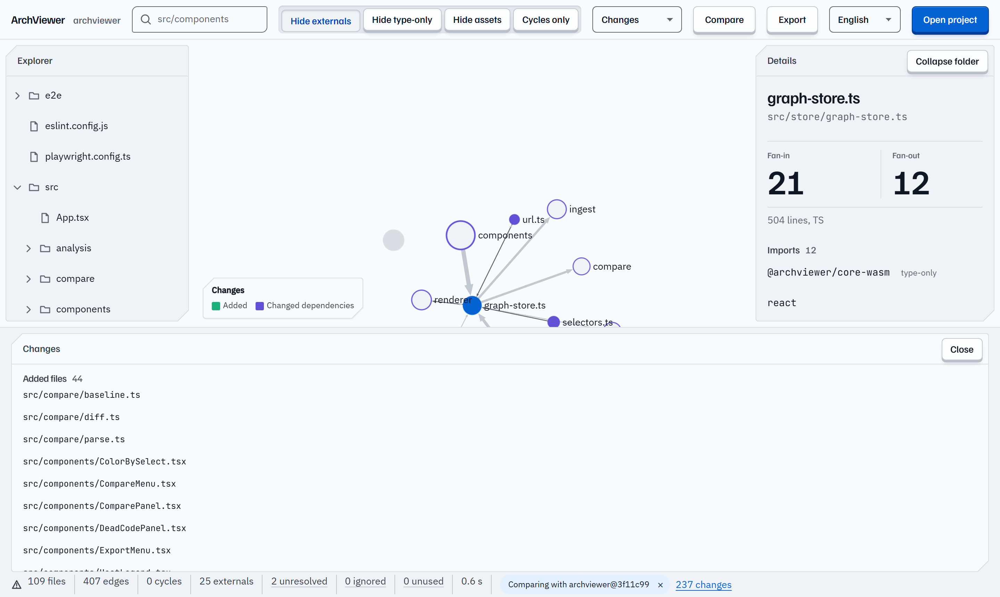

# ArchViewer

> See the architecture of any JavaScript/TypeScript project as an interactive graph, right in your browser. Find hotspots, unused code and what changed between versions. Your code never leaves your machine.

[](https://github.com/engviniciusbs/archviewer/actions/workflows/core.yml)
[](LICENSE)

**[Try it → archviewer.viniciusbsarmento.com](https://archviewer.viniciusbsarmento.com)** · [Leia em português](README.pt-BR.md)



Open a project folder and ArchViewer draws its folders, files and imports as a graph you can expand, collapse and search. A Rust core compiled to WebAssembly does the analysis in your browser. Nothing to install, no account, no upload.

## Features

**Explore**

- **Interactive graph**: WebGL rendering with Sigma.js. Folders start collapsed and expand on demand, so projects with thousands of files stay readable.
- **Explorer, search and details**: a file tree, search by name or path, and a detail panel with fan-in, fan-out, imports, dependents, exports and a code snippet.
- **Accurate imports**: [OXC](https://oxc.rs) parses every file, and imports resolve the way your toolchain resolves them (`tsconfig` paths and references, `package.json` exports, pnpm/npm/yarn workspaces). Dynamic imports, `require` and `new URL('./worker.ts', import.meta.url)` count too.

**Analyze**

- **Cycles and loose ends**: circular dependencies are highlighted, and unresolved imports are listed with the reason.
- **Heatmap**: color the graph by fan-in, fan-out or lines of code to spot hotspots and over-coupled folders. A collapsed folder's fan-in and fan-out only count what crosses its border.
- **Unused code**: files no entry point reaches, files only your tests use, and exports nobody imports. Entry points are detected from `package.json`, `index.html`, Next.js routes, config files, tests and stories.

**Compare and share**

- **Compare versions**: compare the open project with a JSON you exported earlier or with another folder (a second checkout). See added and removed files, new packages, new and removed dependencies, new or resolved cycles, fan-in changes, and color the graph by what changed.
- **Export**: download the current view as PNG or SVG, copy it as a Mermaid diagram, download the full file graph as JSON, or copy a README badge with your file and cycle counts.

**And also**

- **Private by design**: files are read locally and analyzed on your machine. No file, path or metric is sent anywhere.
- **English and Portuguese**: the interface follows your browser language, and a selector switches it. A new language is one file away ([how to translate](CONTRIBUTING.md#translating-archviewer)).

| Unused code | Compare versions |
|---|---|
|  |  |

## Using ArchViewer

1. Open the app in Chrome or Edge and click **Open project**. Pick the root folder of a JS/TS project.
2. Expand folders in the graph or the explorer. Select a node to see its imports, dependents and cycles.
3. **Color by** fan-in, fan-out or lines to find hotspots. The choice is kept in the URL, so a shared link opens with the same view.
4. Click **N unused** in the status bar to review unreachable files and unused exports.
5. **Export** the view as an image or Mermaid, or the whole graph as JSON.
6. **Compare** with a JSON or another folder to see what changed.

**Tracking architecture over time.** The exported JSON is deterministic: the same code always produces the same file. Export it from your main branch (for example at each release), keep it next to your docs, and later compare a feature branch against it with **Compare → With an exported JSON**.

## How it works

```
your folder ──► ingest (browser) ──► Web Worker ──► archviewer-core (Rust → WASM)
                 .gitignore,                         parse (OXC), resolve imports,
                 ignored dirs,                       build graph, find cycles,
                 batched reads                       metrics, entry points, unused code
                                                              │
                                                              ▼
                       React UI ◄── visible graph, details, search, full export (JSON)
                       (Sigma.js / WebGL)          │
                                                   └──► compare two exports, PNG/SVG, Mermaid
```

- Code files: `.ts`, `.tsx`, `.mts`, `.cts`, `.js`, `.jsx`, `.mjs`, `.cjs`. Config read for resolution: `package.json`, `tsconfig*.json`, `jsconfig*.json`, `pnpm-workspace.yaml`, `index.html`.
- Skipped: `node_modules`, `dist`, `build`, `out`, `coverage`, hidden folders, anything in `.gitignore`, and files over 2 MB.
- Comparing with another folder runs a second analysis in its own worker, which is closed when it finishes.
- CI checks the analysis of a 20,000-file synthetic project.

## Limitations

- **JavaScript and TypeScript only.** `.vue` and `.svelte` single-file components are not parsed yet ([#7](https://github.com/engviniciusbs/archviewer/issues/7)).
- **Unused code is heuristic.** Imports built at runtime (`import(variable)`) are not followed, and framework conventions other than Next.js routes are not recognized. Any `pages/` folder counts as Next.js routes. If an entry point is missing, the panel links to an issue form.
- **Comparisons have no rename detection.** A renamed file shows up as removed plus added.
- **No git integration.** To compare branches, export a JSON from one or open a second checkout.

## Browser support

| Browser | Folder access | Status |
|---------|---------------|--------|
| Chrome / Edge | File System Access API | Full support |
| Firefox | File picker (`webkitdirectory`) | Works, without direct folder access |
| Safari | File picker (`webkitdirectory`) | Works, without direct folder access |

## Tech stack

| Layer | Technology |
|-------|-----------|
| Analysis core | Rust 2021, [OXC](https://oxc.rs) parser 0.157 and `oxc_resolver` 11, compiled to WebAssembly with `wasm-bindgen` 0.2.130 and typed with `tsify` |
| Web app | React 19, Vite 6, TypeScript 5, zustand 5 |
| Graph | Sigma.js 3 (WebGL), graphology, ForceAtlas2 layout in a worker |
| Tests | `cargo test` with `insta` snapshots, Vitest 2 + Testing Library, Playwright |
| Monorepo | pnpm workspaces, Turborepo |

## Development

Requirements: Node.js ≥ 20, pnpm ≥ 9, and Rust (stable) with the wasm target.

```bash
rustup target add wasm32-unknown-unknown
cargo install wasm-bindgen-cli --version 0.2.130   # must match Cargo.lock

git clone https://github.com/engviniciusbs/archviewer.git
cd archviewer
pnpm install
pnpm build:wasm                     # compile the Rust core to WebAssembly
pnpm --filter @archviewer/web dev   # http://localhost:5173
```

Run the checks with `cargo test --workspace`, `pnpm --filter @archviewer/web test` and `pnpm --filter @archviewer/web e2e`. The full list, Windows notes and the translation guide are in [CONTRIBUTING.md](CONTRIBUTING.md). Production deployment is described in [docs/deploy.md](docs/deploy.md) (in Portuguese).

```
archviewer/
├── crates/archviewer-core/   # Rust core: parsing, resolution, graph, cycles, metrics, dead code, export
├── packages/core-wasm/       # wasm-bindgen wrapper with a typed JS API
├── apps/web/                 # React + Vite + Sigma app (i18n, heatmap, export, compare)
├── fixtures/                 # sample projects used by the tests (sample-project, monorepo-pnpm, dead-code…)
└── docs/                     # design specs, plans, deploy notes and screenshots
```

## Roadmap

Everything on the first roadmap has shipped: English interface, export and share, heatmap, unused code, and version comparison. Ideas being considered next: a monorepo package view, more languages, and a native CLI on top of `archviewer-core` for CI checks.

Follow and discuss in the [roadmap issue](https://github.com/engviniciusbs/archviewer/issues/8).

## Contributing

Issues and pull requests are welcome. Look for [`good first issue`](https://github.com/engviniciusbs/archviewer/labels/good%20first%20issue) to get started, and read [CONTRIBUTING.md](CONTRIBUTING.md) before opening a PR. This project follows a [Code of Conduct](CODE_OF_CONDUCT.md).

## License

[MIT](LICENSE)
