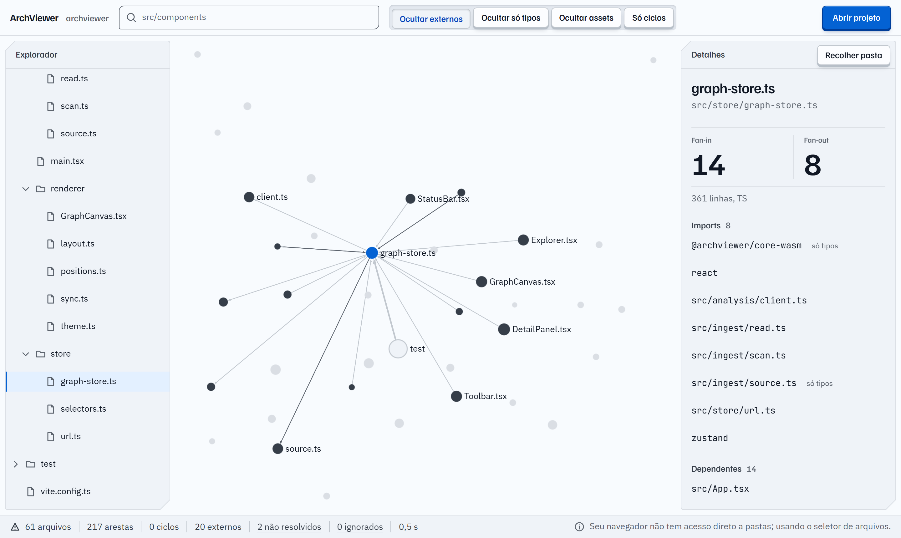

# ArchViewer

> Veja a arquitetura de qualquer projeto JavaScript/TypeScript como um grafo interativo, direto no navegador. Seu código não sai da sua máquina.

[](https://github.com/engviniciusbs/archviewer/actions/workflows/core.yml)
[](LICENSE)

**[Experimente → archviewer.viniciusbsarmento.com](https://archviewer.viniciusbsarmento.com)** · [Read in English](README.md)



Abra a pasta de um projeto e o ArchViewer desenha as pastas, os arquivos e os imports como um grafo que você expande, recolhe e pesquisa. Sem instalar nada, sem conta, sem upload.

## Recursos

- **Grafo interativo**: renderizado em WebGL com Sigma.js e graphology. As pastas começam recolhidas e se expandem sob demanda, então projetos grandes continuam legíveis.
- **Análise precisa em WebAssembly**: um núcleo em Rust baseado no [OXC](https://oxc.rs) faz o parsing da AST de cada arquivo e resolve os imports como a sua toolchain resolve (paths e references do `tsconfig`, `exports` do `package.json`, workspaces). Tudo roda num Web Worker.
- **Ciclos e pendências**: dependências circulares ficam destacadas, e os imports não resolvidos aparecem listados com o motivo.
- **Explorador, busca e detalhes**: árvore de arquivos, busca por nome ou caminho e um painel com fan-in, fan-out, imports, dependentes e um trecho do código.
- **Entende monorepos**: workspaces do pnpm e do npm/yarn são detectados e aparecem como pacotes.
- **Exportar e compartilhar**: baixe a visão atual em PNG ou SVG, copie como diagrama Mermaid, baixe o grafo completo de arquivos em JSON ou copie um badge para o README com as contagens de arquivos e ciclos.
- **Inglês e português**: a interface segue o idioma do navegador, e um seletor troca o idioma. Um idioma novo é um arquivo a mais ([como traduzir](CONTRIBUTING.md#translating-archviewer), em inglês).
- **Privado por construção**: os arquivos são lidos localmente e analisados na sua máquina. Nenhum arquivo, caminho ou métrica é enviado a lugar algum.

## Como funciona

```
sua pasta ──► ingest (navegador) ──► Web Worker ──► archviewer-core (Rust → WASM)
               .gitignore,                           parsing (OXC), resolve imports,
               pastas ignoradas,                     monta o grafo, acha ciclos
               leitura em lotes                                │
                                                               ▼
                              Interface React ◄── grafo visível, detalhes, busca
                              (Sigma.js / WebGL)
```

- Arquivos de código: `.ts`, `.tsx`, `.mts`, `.cts`, `.js`, `.jsx`, `.mjs`, `.cjs`.
- Ficam de fora: `node_modules`, `dist`, `build`, pastas ocultas, o que estiver no `.gitignore` e arquivos acima de 2 MB.
- O CI confere a análise de um projeto sintético com 20 mil arquivos.

## Suporte de navegadores

| Navegador | Acesso a arquivos | Status |
|-----------|-------------------|--------|
| Chrome / Edge | File System Access API | Suporte completo |
| Firefox | Seletor de arquivos (`webkitdirectory`) | Funciona, sem acesso direto à pasta |
| Safari | Seletor de arquivos (`webkitdirectory`) | Funciona, sem acesso direto à pasta |

## Desenvolvimento

Você precisa de Node.js ≥ 20, pnpm ≥ 9 e Rust com o target wasm:

```bash
rustup target add wasm32-unknown-unknown
cargo install wasm-bindgen-cli --version 0.2.130   # igual à do Cargo.lock

git clone https://github.com/engviniciusbs/archviewer.git
cd archviewer
pnpm install
pnpm build:wasm
pnpm --filter @archviewer/web dev
```

Testes, organização do projeto e notas para Windows estão no [CONTRIBUTING.md](CONTRIBUTING.md) (em inglês).

```
archviewer/
├── crates/archviewer-core/   # núcleo em Rust: parsing, resolução, grafo, ciclos
├── packages/core-wasm/       # wrapper wasm-bindgen com API JS tipada
├── apps/web/                 # app React + Vite + Sigma
└── fixtures/sample-project/  # projeto de exemplo usado nos testes
```

O deploy de produção está descrito em [docs/deploy.md](docs/deploy.md).

## Roadmap

Os próximos passos, mais ou menos nesta ordem:

- **Métricas e heatmap**: colorir os nós por fan-in, fan-out e tamanho para achar pontos críticos
- **Código morto**: arquivos que ninguém importa e exports sem uso
- **Comparar versões**: o que mudou na arquitetura entre duas branches

Acompanhe na [issue de roadmap](https://github.com/engviniciusbs/archviewer/issues/8). Ideias são bem-vindas.

## Contribuindo

Issues e pull requests são bem-vindos. Procure por [`good first issue`](https://github.com/engviniciusbs/archviewer/labels/good%20first%20issue) para começar e leia o [CONTRIBUTING.md](CONTRIBUTING.md) antes de abrir um PR. Issues e PRs podem ser em português ou em inglês. O projeto segue um [Código de Conduta](CODE_OF_CONDUCT.md).

## Licença

[MIT](LICENSE)
